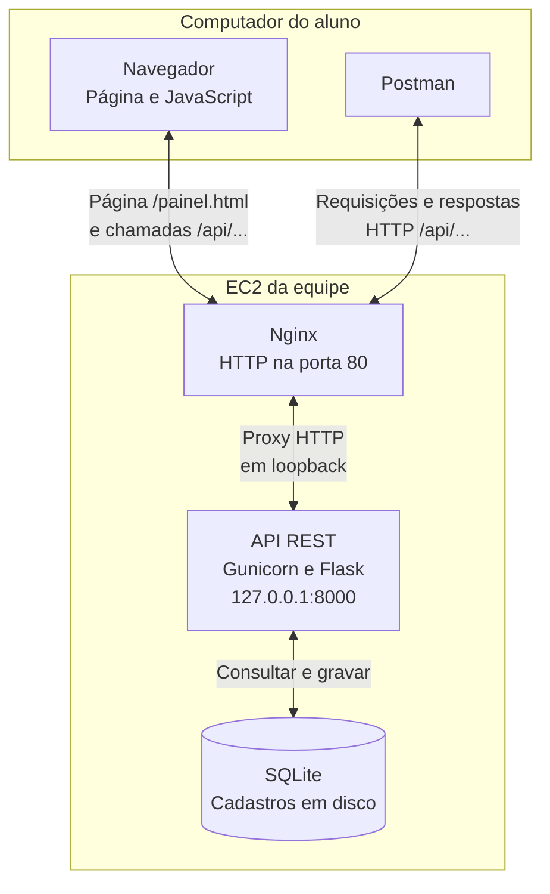

# 5. Usar a aplicação web

**Objetivo:** mostrar como ações na tela são transformadas em requisições para a API. Use a página pronta; não é necessário editar HTML ou JavaScript.

## 5.1. Localizar cada componente

O diagrama é renderizado a partir de Mermaid. [Baixe o código `.mmd`](diagramas/arquitetura-rest.mmd) para reutilizar em outro renderizador.

O Nginx entrega a página e encaminha as chamadas `/api/...` para o backend por HTTP em loopback. O JavaScript da interface roda no **navegador do usuário** e chama a API; quem valida as requisições e grava os cadastros é o backend na EC2.

**Verifique:** quem armazena o inventário? Se fecharmos a aba, o banco é apagado? Qual caminho do diagrama muda quando trocamos o navegador pelo Postman?

## 5.2. Observar a primeira chamada da página

**Onde:** navegador no seu computador.

1. Abra `http://SEU_DNS_EC2/painel.html`, com o endereço real da sua EC2.
2. Mantenha **URL base da API = `/api`**. Informe a chave de **g01**.
3. Abra as ferramentas de desenvolvimento: no Windows/Ubuntu, `F12` ou `Ctrl+Shift+I`; no macOS, `Command+Option+I`. Se o navegador não abrir, use seu menu de ferramentas do desenvolvedor.
4. Selecione **Network/Rede**, deixe o filtro em **All/Todos** ou **Fetch/XHR** e limpe a lista de requisições.
5. Clique **Conectar / listar** na página.
6. Selecione a linha de `/api/equipamentos`. Observe **Request URL**, **Request Method**, **Status Code** e a aba **Response/Resposta**.

**Esperado:** GET para `/api/equipamentos`, status 200 e JSON com `itens` e `total`. A tabela da página apresenta os itens retornados.

**Verifique:** que parte da resposta se tornou cada linha da tabela? Onde está a chave: corpo, cabeçalho ou URL? Oculte o valor da chave antes de registrar evidências.

## 5.3. Criar na página e ler no Postman

1. Na página, cadastre `IHM-A-WEB-01`, tipo **IHM**, local **Planta A**, ativo marcado. Se o nome já existir, escolha outro nome e registre-o.
2. Clique **Salvar** e localize o **POST** em Network. Observe seu JSON em **Payload/Request/Requisição** e o status 201.
3. Copie o ID da resposta. A página também pode exibi-lo na tabela.
4. No Postman, com o **ambiente de g01**, envie GET `{{baseUrl}}/api/equipamentos/ID_REAL`, substituindo `ID_REAL` pelo número que acabou de copiar, com API Key e sem corpo.

**Esperado:** GET 200 com o mesmo ID, nome, tipo, local e ativo apresentados na página.

**Verifique:** o POST foi enviado pelo navegador ou pelo Python? Qual evidência mostra que os dois clientes acessam o mesmo recurso?

Depois de salvar, a página pode fazer um GET automático para atualizar a tabela. Para avaliar a criação, selecione especificamente a linha **POST**, e não apenas a última requisição da lista.

## 5.4. Alterar em ambos os sentidos

1. No Postman, envie PATCH para o ID real com `{"ativo":false}` em **Body → raw → JSON**.
2. Confirme status 200. Volte à página e clique **Conectar / listar** novamente: o campo ativo deve aparecer como **Não**.
3. Na página, clique **Ler / editar** nesse item. Observe o GET individual em Network.
4. No formulário preenchido, altere **Local** para **Planta C** e salve. Observe o **PUT** com os quatro campos editáveis e status 200.
5. No Postman, faça GET do mesmo ID e confirme **Planta C**.
6. Na página, clique **Alternar ativo**, observe o **PATCH** e confira por GET no Postman.

**Esperado:** as mudanças feitas por um cliente são visíveis pelo outro após uma nova consulta. Um cliente não precisa ficar aberto para que o outro opere sobre o recurso.

**Verifique:** por que atualizar a página/consultar novamente foi necessário? Como o contrato permite criar outra interface para a mesma API sem reescrever o armazenamento?

## 5.5. Excluir e interpretar 204

1. Na página, clique **Excluir** no item de ensaio e confirme.
2. Em Network, selecione a requisição **DELETE**. Confira 204 e ausência de corpo.
3. No Postman, faça GET do ID excluído.

**Esperado:** a linha some da tabela, o DELETE retorna 204 e o GET individual retorna 404. A página pode fazer um GET 200 da **coleção** depois do DELETE para atualizar a lista: são recursos e requisições diferentes.

**Verifique:** por que 200 na listagem depois da exclusão não contradiz 404 no item? Por que a interface precisa tratar uma resposta sem JSON?

## 5.6. Explicar origem e autenticação

Uma origem reúne **esquema, host e porta**. A página em `http://SEU_DNS_EC2` usa `/api` na mesma origem. A porta interna 8000 não aparece na URL pública.

Se outro site tentar consumir essa API pelo navegador, poderá precisar de uma política CORS que autorize a origem exata. O Postman Desktop não impõe essa mesma política de navegador. CORS não substitui autenticação ou criptografia; nesta prática, use a página da própria EC2.

**Verifique:** por que funcionar no Postman não garante que qualquer página conseguirá chamar a API? Por que mudar para `mode: 'no-cors'` não é uma solução para ler as respostas?

**Registre:** uma captura de Network com método, caminho, status e JSON, com a chave oculta, e uma explicação da sequência **clique → requisição → processamento da API → resposta → atualização da tela**.

??? note "Depois de comparar os clientes, confira seu raciocínio"

    - O navegador executa o JavaScript e envia a requisição; o backend valida a credencial e o corpo, consulta/grava o banco e responde.
    - Ler no Postman o ID criado pela página comprova que ambos acessam o mesmo recurso. Atualizar a tela apenas pede outra representação ao servidor.
    - No caminho pelo navegador, o Nginx também entrega os arquivos da interface. As operações do Postman e da página alcançam a mesma API e o mesmo banco.
    - CORS é uma política de acesso entre origens aplicada pelo navegador; não é a chave da API nem criptografia do transporte.

Avance para [6. Diagnosticar](06-diagnosticar.md).
