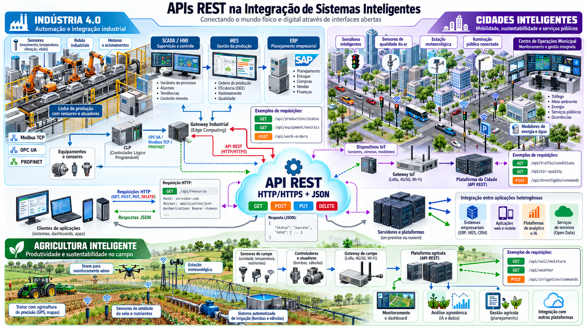

# Prática REST na EC2

Você vai iniciar um inventário pronto de equipamentos fictícios das Plantas A/B/C e investigar como o Postman e uma página web utilizam a mesma API.

**Este é o roteiro completo.** Siga as etapas na ordem do menu. Os arquivos, as instruções e as atividades estão neste repositório; nenhum PDF é necessário para realizar a prática.

*Panorama de integração por APIs REST. Clique na ilustração para abrir em tamanho original.* Os endpoints e a autenticação mostrados são exemplos de outros contextos; neste laboratório, usaremos o inventário em `/api/equipamentos` e o cabeçalho `X-API-Key`.

## O que você vai aprender

- Relacionar recursos, URLs, métodos HTTP e representações JSON.
- Criar, consultar, alterar e excluir cadastros, verificando o efeito de cada requisição.
- Interpretar status de sucesso e erro, autenticação e autorização.
- Mostrar que uma interface web transforma ações do usuário em chamadas à API.
- Distinguir problemas de rede, proxy, autenticação e aplicação.

**Organização sugerida:** duplas/trios, uma EC2 por equipe. Reserve 20–30 minutos para iniciar o ambiente pela primeira vez e cerca de 120 minutos para investigar os serviços. Você utilizará programas e scripts prontos; as atividades não exigem implementar o backend ou compilar uma interface.

## Onde cada etapa acontece

| Local | O que você faz | Como reconhecer |
| --- | --- | --- |
| **Seu computador** | Baixa o repositório, guarda a chave SSH, usa Postman e navegador. | Terminal do WSL, Ubuntu ou macOS. |
| **EC2, por SSH** | Executa os scripts e consulta serviços e logs. | Após conectar, o prompt costuma começar com `ubuntu@...`. |
| **Console AWS** | Confere instância, DNS, IP, Security Group e término. | Página da AWS no navegador. |

Você manterá **dois terminais**: A conectado à EC2 e B no seu computador. Não digite comandos locais dentro da sessão SSH. Se fechar o terminal A, reconecte com o mesmo comando SSH da etapa 1.

## Percurso da prática

| Etapa | Resultado para avançar |
| --- | --- |
| [1. Preparar e conectar](01-preparar.md) | Repositório baixado no seu computador e sessão SSH aberta. |
| [2. Iniciar na EC2](02-iniciar.md) | Scripts terminam e validação mostra `OK`. |
| [3. Acessar](03-acessar.md) | Postman configurado e página HTTP aberta. |
| [4. Investigar REST](04-investigar.md) | Operações HTTP executadas e efeitos confirmados por GET. |
| [5. Usar a aplicação web](05-aplicacao-web.md) | Mesmo cadastro acessado pelo Postman e pela página. |
| [6. Diagnosticar](06-diagnosticar.md) | Falhas previstas identificadas, explicadas e recuperadas. |
| [7. Registrar e encerrar](07-encerrar.md) | Evidências salvas e recursos da equipe encerrados. |

Em cada etapa, faça a ação, compare com o resultado esperado e responda à pergunta de verificação. Se o resultado diferir, use a orientação de correção antes de continuar.

## Antes de começar

Tenha uma conta AWS autorizada para criar/usar uma EC2 Ubuntu Server 24.04 LTS, acesso à Internet, um terminal e o Postman Desktop instalado no seu computador. O roteiro explica a preparação de uma instância dedicada. Conta, permissões e cota AWS são pré-requisitos: o script não os cria.

Nas abas, escolha **WSL**, **Ubuntu** ou **macOS** conforme o sistema do seu computador. Quem usa Windows com Ubuntu no WSL deve escolher **WSL** e executar os comandos naquele terminal.

O percurso usa **HTTP na porta 80** para concentrar o trabalho em REST. HTTP transmite os dados sem criptografia: use somente dados e chaves de laboratório e restrinja o Security Group ao seu IP/rede autorizada. [HTTPS é um aprofundamento opcional](https-opcional.md).

O campo `ativo` é um dado do inventário: não liga ou desliga máquinas. Todos os registros são fictícios.

## O que já foi validado

O contrato da API, o validador em HTTP local e a construção desta documentação têm verificações registradas. A instalação integral em uma EC2 real e o uso do Postman nas três plataformas ainda precisam de ensaio. Consulte o [estado da validação](validacao.md); documentação completa e validação completa na AWS são condições diferentes.
